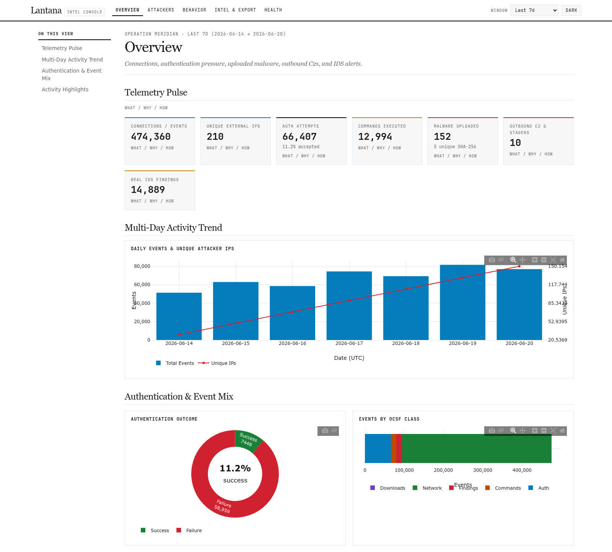
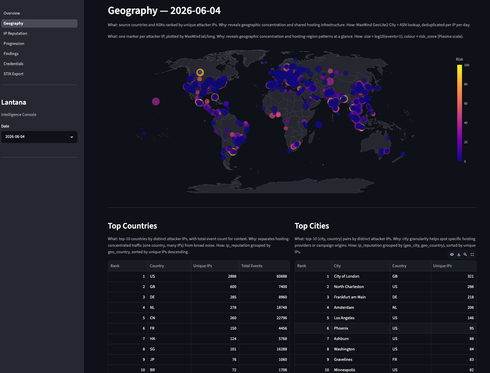
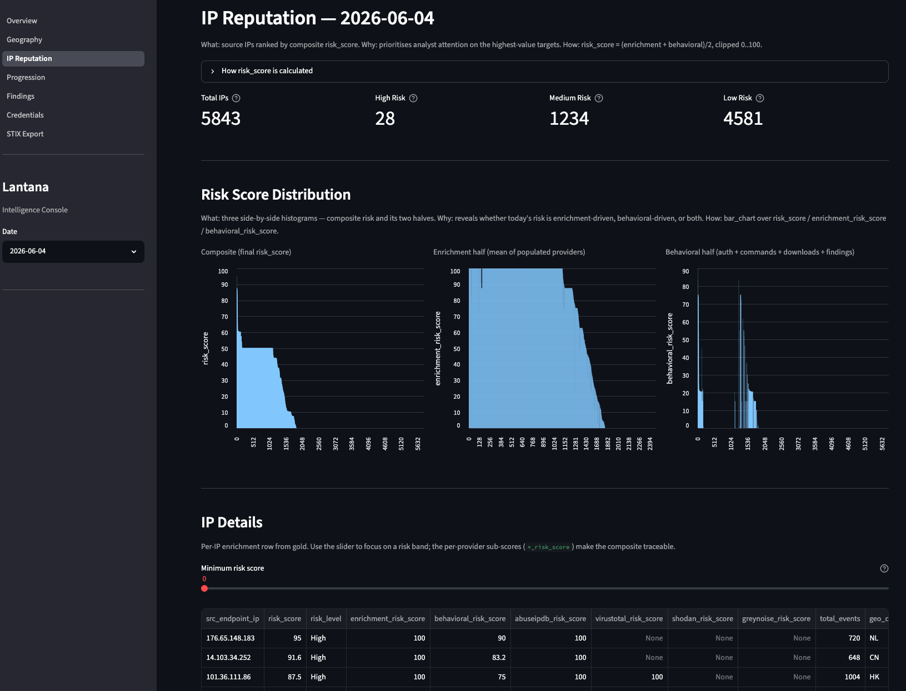
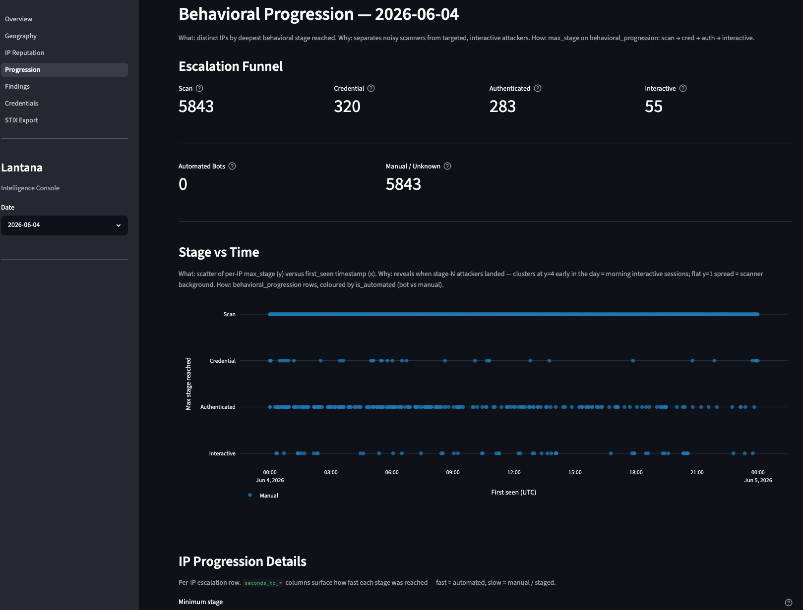
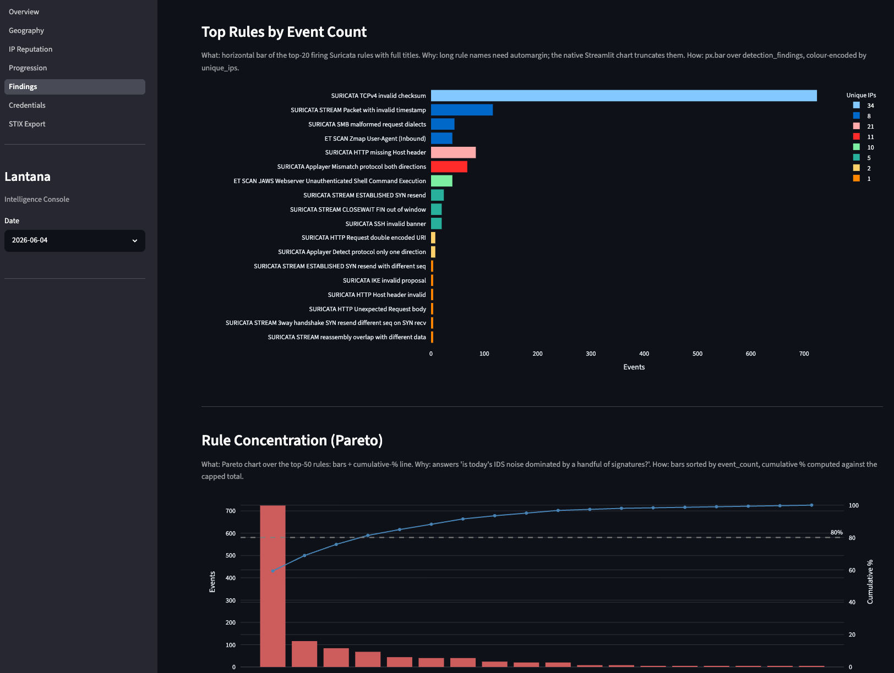
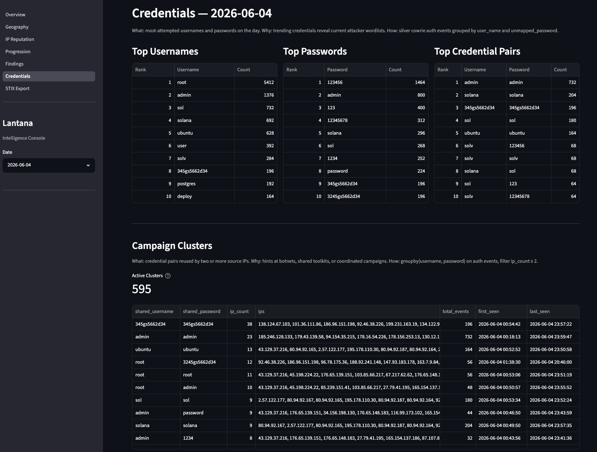
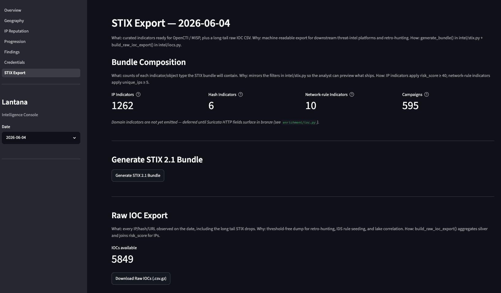
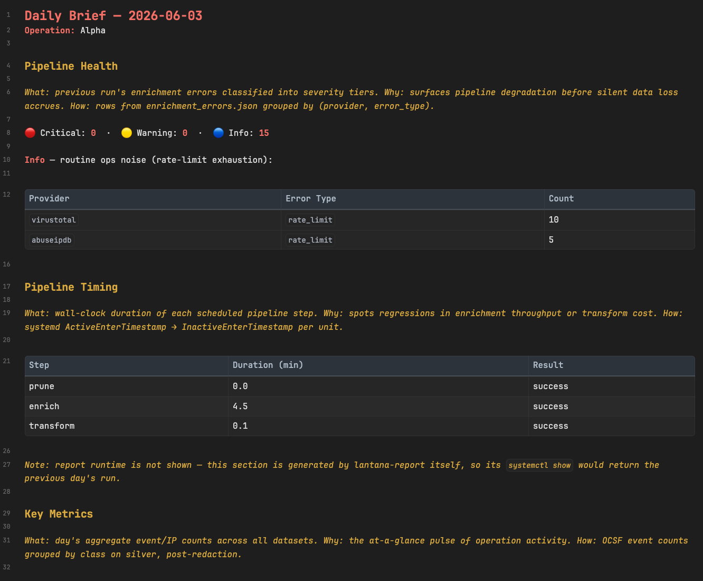
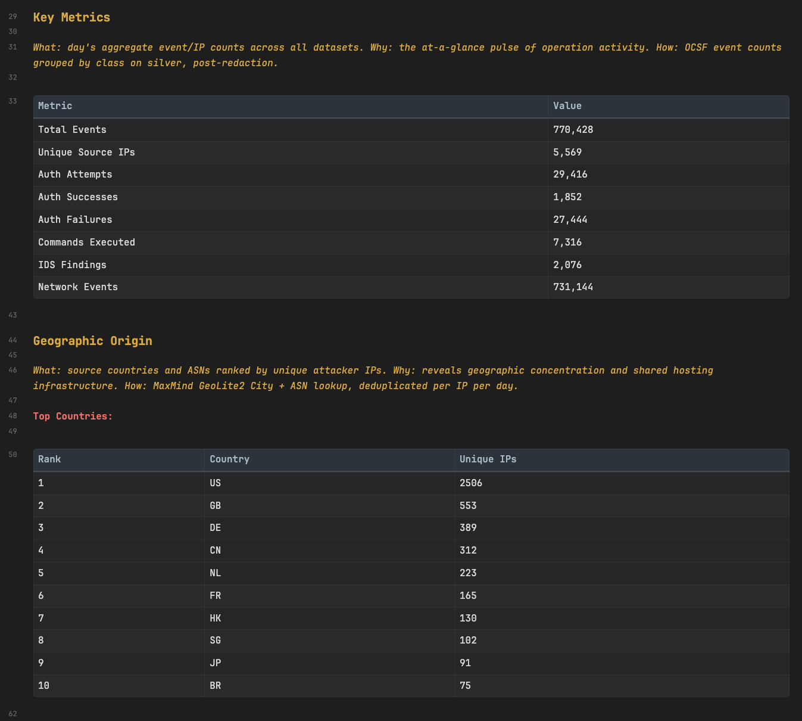
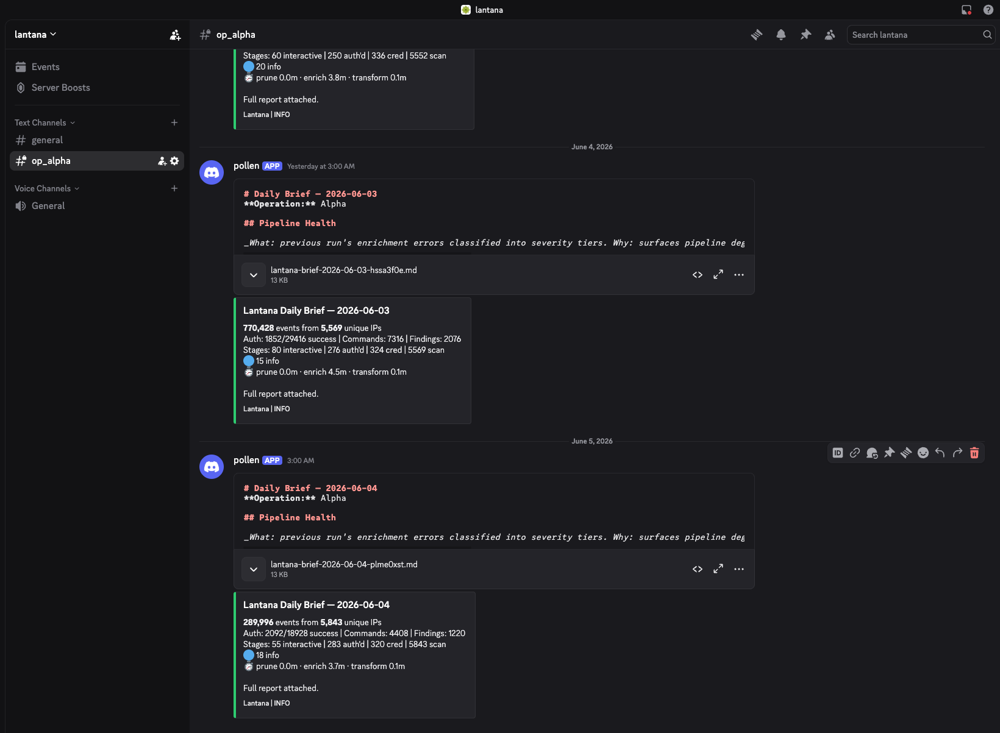

# Lantana

<p align="center">
  
</p>

<p align="center">
  <a href="https://github.com/lopes/lantana/actions/workflows/ci.yml"></a>
  <a href="https://github.com/lopes/lantana/actions/workflows/codeql.yml"></a>
  <a href="LICENSE"></a>
  
  
</p>

**Lantana is a honeypot-as-code platform.** Deploy IPv4/IPv6 dual-stack honeypots from an Ansible inventory, capture attacker behavior into a typed datalake, and ship intelligence as Discord briefs, STIX bundles, and an air-gapped Vigil dashboard. Aligned with [MITRE Engage](https://engage.mitre.org/) — honeypots are treated as disposable infrastructure that gets rotated and reshaped as narratives evolve.

The platform covers the full lifecycle: controlled exposure → structured ingestion → enrichment → analysis → intelligence output. Designed for disposability, policy-driven deployment, and strict blast-radius containment.

> [!tip]
> [Lantana camara](https://en.wikipedia.org/wiki/Lantana_camara) is a plant that attracts insects with its colorful flowers — much like a honeypot attracts attackers with its deliberately vulnerable services. It's invasive, resilient, and thrives in hostile environments.

---

## Platform Preview

<p align="center">
  <table>
    <tr>
      <td align="center">
        
        <br><sub>Vigil dashboard — overview</sub>
      </td>
      <td align="center">
        
        <br><sub>Dashboard — geography</sub>
      </td>
    </tr>
  </table>
</p>

<details>
<summary>More screenshots</summary>

<p align="center">
  <table>
    <tr>
      <td align="center">
        
        <br><sub>Dashboard — IP reputation</sub>
      </td>
      <td align="center">
        
        <br><sub>Dashboard — behavioral progression</sub>
      </td>
    </tr>
    <tr>
      <td align="center">
        
        <br><sub>Dashboard — findings</sub>
      </td>
      <td align="center">
        
        <br><sub>Dashboard — credentials</sub>
      </td>
    </tr>
    <tr>
      <td align="center">
        
        <br><sub>Dashboard — STIX export</sub>
      </td>
      <td align="center">
        
        <br><sub>Report — Discord embed header</sub>
      </td>
    </tr>
    <tr>
      <td align="center">
        
        <br><sub>Report — key metrics</sub>
      </td>
      <td align="center">
        
        <br><sub>Discord daily intelligence brief</sub>
      </td>
    </tr>
  </table>
</p>

</details>

---

## Quick Start

### 1. Clone and provision

```bash
git clone https://github.com/lopes/lantana.git
cd lantana
```

Provision a [Debian 13](https://www.debian.org/) host (VM or bare metal). Terraform support for Proxmox is available under `infra/terraform/environments/proxmox/`.

### 2. Create an operation

```bash
cd config/ansible
cp -r inventories/op_single inventories/op_myop
```

Customize `inventory.yml`, `main.yml`, `network.yml`, `narrative.yml`, and `reporting.yml` under `inventories/op_myop/group_vars/all/`. See the [setup guide](/docs/setup.md) for an annotated walkthrough of each file. Create the encrypted vault:

```bash
ansible-vault create inventories/op_myop/group_vars/all/vault.yml
```

### 3. Deploy

```bash
ansible-playbook -i inventories/op_myop/inventory.yml playbooks/deploy_single.yml --ask-vault-pass
ansible-playbook -i inventories/op_myop/inventory.yml playbooks/deploy_honeypots.yml --ask-vault-pass
```

### 4. Validate

```bash
ansible-playbook -i inventories/op_myop/inventory.yml tests/validate-single-node.yml -vvv --ask-vault-pass
```

---

## Rules of Engagement

Lantana is designed to operate safely in hostile environments and assumes that sensor hosts will eventually be compromised. To ensure ethical, legal, and operational safety, the platform enforces these rules at both architectural and operational levels:

1. **No offensive use.** Honeypots must never be used as offensive infrastructure. The honeywall zone enforces outbound restrictions by default — compromised hosts cannot scan, attack, or otherwise harm third parties. Egress allowances must be explicit and narrowly scoped.
2. **Assume disposability.** No secrets, credentials, production access, or sensitive systems on sensor hosts. Any compromise is total. Rebuilds are routine, not exceptional.
3. **No entrapment.** Honeypots must not target specific individuals or organizations without explicit legal authorization. Lantana is broad-spectrum research, not targeted intelligence collection.
4. **Respect privacy.** Captured data must be handled, stored, and processed according to applicable policies, regulations, and ethical standards.
5. **Align with operational goals.** Narratives, exposure profiles, and sensor configurations must answer specific questions. Sensor rotation and topology shifts are part of the lifecycle, not ad hoc events.
6. **No infrastructure disclosure.** Real operator-identifying values (WAN IPs, hostnames, domains, ASNs, SSH host fingerprints) must never appear in any artifact leaving the operator's control — that includes Discord reports, STIX bundles, this repository, commits, talks, screenshots. Real values live only inside each operation's untracked or vault-encrypted inventory. Examples in tracked files use RFC 5737 / 3849 / 2606 / 5398 documentation ranges.

---

## Project Structure

```
lantana/
  config/ansible/     # Ansible roles, playbooks, inventories, validation playbooks
  containers/         # Self-owned pinned Cowrie and Dionaea container images
  infra/terraform/    # Terraform host provisioning (Proxmox)
  pipeline/           # Python data pipeline (enrichment, OCSF, Vigil dashboard, reports, STIX)
  scripts/            # Operational scripts (bootstrap, backup, probes, dashboard)
  docs/               # Full documentation
```

---

## Documentation

| Document | Description |
|---|---|
| [Architecture](/docs/architecture.md) | Zoned model, deployment modes, network topology, tech stack |
| [Setup Guide](/docs/setup.md) | First-deploy walkthrough: prepare server, clone an operation, vault, narrative, deploy honeypots |
| [Pipeline](/docs/pipeline.md) | Data pipeline: bronze/silver/gold datalake, OCSF normalization, enrichment, reports, STIX |
| [Integrations](/docs/integrations.md) | Third-party threat-intel providers: endpoints, auth, rate limits, field extraction, live-probe workflow |
| [Validation](/docs/validation.md) | Post-deploy verification: protocol smoke tests + day-by-day pipeline/report/dashboard checks |
| [Risk Scoring](/docs/risk-scoring.md) | Composite + per-provider risk score formula, RIOT short-circuit, decomposition |
| [Honeypots](/docs/honeypots.md) | Cowrie + Dionaea: per-honeypot config model, capability allowlist, persona drift notes |
| [Troubleshooting](/docs/troubleshooting.md) | Common issues and fixes (Dionaea startup, nftables, Vector pipeline) |
| [Glossary](/docs/glossary.md) | Terminology and definitions |

---

## Design Decisions

Lantana intentionally avoids Kubernetes (honeypots are disposable, not HA), SIEM-first architectures (research honeypot data benefits from batch analytics over real-time alerting), and monolithic stacks like T-Pot (Lantana is composable — infrastructure, policy, sensors, and narratives evolve independently).

For the full rationale, see [docs/architecture.md](/docs/architecture.md).

---

## Roadmap

Tracked work across v1.5 and future cuts. Boxes get checked as items land.

- [x] **Dionaea download URL + per-session `src_ip` attribution → pipeline.** Shipped in v1.5 via the custom `lantana_json` ihandler in `ghcr.io/lopes/lantana-dionaea:v1.5`, subscribing to `dionaea.download.complete.{unique,again}` and emitting `dionaea.binary.captured` events with `src_ip`, SHA-256 `shasum`, and `download_url` directly into `dionaea.json` (with the `00:10 UTC` POSIX ACL + date-scoped disk hash scan kept as a deduplicated fallback).
- [x] **Dionaea MSSQL/MySQL command bodies & HTTP POST capture → pipeline.** Shipped in v1.5 via `lantana_json` (`sql_command` on MSSQL/MySQL) and `patch_http.py` (structured HTTP POST/JSON payload capture without leaking `http-*.tmp` files).
- [x] **SHA-256 hash integration for dionaea binaries.** Implemented via `lantana_json` attributed bronze events plus the `00:10 UTC` `lantana-grant-read` POSIX ACL fallback, VirusTotal hash enrichment (`vt_file_*` + `vhash` clustering), gold `extracted_iocs`, the daily brief, and STIX 2.1 file indicators.
- [x] **Self-built pinned honeypot images.** Shipped in v1.5: `containers/{cowrie,dionaea}/` built by GitHub Actions from pinned upstream git commits and published to `ghcr.io/lopes/lantana-{cowrie,dionaea}:v1.5`, locking in-container UIDs (`999`/`1000`), baking `dionaea.cfg` (`processors=filter_emu`, zero `bistreams`), and preserving host POSIX ACLs across restarts.
- [x] **Dashboard date-range selector & air-gapped Vigil console.** Shipped in v1.5: replaced Streamlit with a self-contained, zero-CDN `vigil`-themed stdlib HTTP console (`127.0.0.1:8501`) supporting 5 date windows (Day, 7d, 30d, Custom range, All) across 5 CTI-grouped views (`Overview`, `Attackers`, `Behavior`, `Intel & Export`, `Health`), dropping 25 runtime packages.
- [ ] **Multi-day slow-burn detection — proper version.** The v1.0.0 multi-day progression gold table was retired (it OOM'd the 7.6 GB collector at a 7-day silver lookback). The dashboard's Multi-Day Progression section now derives a multi-day flag from daily `behavioral_progression` gold across the selected window — cheap, but lossy: it can't see the silver-only per-stage timestamps the old logic used (e.g. day of first credential attempt vs day of first interactive command), so "Multi-Day IPs" is a permissive proxy for slow-burn behaviour rather than a stage-progression signal. A proper rewrite would either (a) compute per-day per-stage timestamps at silver→gold time and store them in the daily `behavioral_progression` partition, then aggregate at the dashboard, or (b) stream the multiday computation per-day to avoid the silver concat. Either approach keeps the slow-burn detection lossless without the OOM risk.

---

## License

This project is licensed under the [MIT License](/LICENSE).
