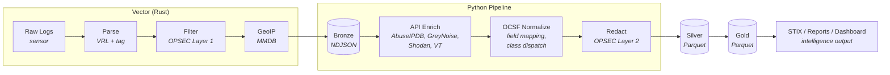

# Lantana: Data Pipeline

The Lantana data pipeline is a Python application that processes honeypot telemetry through a three-tier data lake (bronze, silver, gold), producing enriched Parquet datasets, threat intelligence reports, STIX 2.1 bundles, and an air-gapped Vigil operator console. It runs on the Collector zone via systemd `oneshot` services triggered by systemd timers (`lantana-prune.timer` at `00:15 UTC`, `lantana-enrich.timer` at `01:00 UTC`, `lantana-transform.timer` at `05:30 UTC`, `lantana-report.timer` at `06:00 UTC`, plus manual/replay `lantana-alert.service` — 5 `.service` units and 4 `.timer` units total), alongside lightweight cron jobs for `00:10 UTC` symlink-safe POSIX ACL refreshes (`lantana-grant-read`), monthly GeoIP refreshes (`lantana-geoip-update`), and deterministic log rotation (`lantana-logs`).

---

## 1. Overview

Vector writes raw honeypot logs to the **bronze** layer as NDJSON files. The Python pipeline reads bronze, enriches it with external threat intelligence APIs, normalizes events to [OCSF](https://ocsf.io/) (Open Cybersecurity Schema Framework), redacts infrastructure IPs (OPSEC), and writes the result to the **silver** layer as Parquet. A second stage aggregates silver into the **gold** layer for dashboards and intelligence output.



### Why Python instead of Vector for enrichment and normalization?

Vector handles high-throughput ingest, parsing, noise filtering, and GeoIP enrichment at wire speed. The Python pipeline handles work that doesn't fit a streaming model:

- **API enrichment** requires rate-limited HTTP calls with caching, retries, and backoff — better suited to async Python with SQLite cache than VRL.
- **OCSF normalization** involves conditional class dispatch (which OCSF event class each raw event maps to) based on event type — complex branching logic that's easier to test and maintain in Python.
- **OPSEC redaction** is a safety-critical step that benefits from Pydantic validation and comprehensive test coverage.
- **Gold aggregation** produces cross-dataset correlations (behavioral progression, campaign clustering) that require Polars DataFrame operations.

Bronze stays raw. This preserves the option to re-normalize if the OCSF mapping changes without re-ingesting from the honeypots.

---

## 2. Datalake Structure

All data lives under `/var/lib/lantana/datalake/` in Hive-style partitions:

```text
/var/lib/lantana/datalake/
├── bronze/                                    # Raw NDJSON (Vector writes)
│   └── dataset={name}/date={YYYY-MM-DD}/server={hostname}/events.json
├── silver/                                    # Enriched + OCSF-normalized Parquet
│   └── dataset={name}/date={YYYY-MM-DD}/server={hostname}/events.parquet
└── gold/                                      # Aggregated intelligence Parquet
    └── {table_name}/date={YYYY-MM-DD}/summary.parquet
```

- **Bronze**: One NDJSON file per dataset/date/server combination. Written by Vector. Contains raw event fields plus Vector-added tags (`dataset`, `server`, `operation`) and GeoIP fields (`geo.*`).
- **Silver**: One Parquet file per partition. Events have OCSF-normalized column names, API enrichment data, and infrastructure IPs replaced with pseudonyms.
- **Gold**: Seven aggregated tables per date: `daily_summary`, `ip_reputation`, `behavioral_progression`, `campaign_clusters`, `geographic_summary`, `detection_findings`, and `extracted_iocs`. Read exclusively from silver.

Multiple operations coexist via the `operation` column tag, not filesystem partitions.

---

## 3. Pipeline Stages

### 3.1 Bronze to Silver (daily enrichment)

Entry point: `lantana-enrich` (systemd timer: `lantana-enrich.timer` at `01:00 UTC`, processes yesterday's data).

For each dataset (`cowrie`, `suricata`, `nftables`, `dionaea`):

1. **Read bronze** NDJSON via streaming `\x00`-safe ingestion (`read_bronze_ndjson`) for every dataset into Polars DataFrames (with `lantana_json` already writing attributed `dionaea.binary.captured` rows carrying `src_ip`, SHA-256 `shasum`, and `download_url`; `extract_dionaea_binary_events()` stays as a date-scoped, hash-deduplicated fallback over `/var/lib/lantana/sensor/dionaea/binaries/` enabled by the `00:10 UTC` `lantana-grant-read` POSIX ACL refresh).
2. **Extract IOCs globally** across all datasets — unique inbound source IPs (sorted by behavioral engagement priority), malware SHA-256 hashes (bronze + date-scoped disk fallback), outbound C2 IPs, and post-auth stager URLs & domains (`enrichment/ioc.py`). An IOC appearing in multiple datasets is queried once, not twice.
3. **OPSEC-filter IOCs** against `RedactionConfig` (`infrastructure_ips`, derived variants, `infrastructure_cidrs`, `infrastructure_hostnames`, plus non-routable RFC 1918 / loopback / link-local / ULA ranges) — operation-owned addresses and hostnames never reach an external provider.
4. **Query optional enrichment providers** cache-first with token-bucket pacing (`_AsyncRateLimiter` honoring `provider.rate_limit()`):
   - AbuseIPDB (abuse confidence, report count) — IPs (optional; skipped cleanly if key unset)
   - GreyNoise (classification, noise/riot status, last seen, label) — IPs — see [Provider auth modes](#72-provider-auth-modes)
   - Shodan (open ports, OS, org, ASN, vulns) — IPs (optional; skipped cleanly if key unset)
   - VirusTotal / opt-in commercial GTI — unified priority queue (`hashes -> outbound C2 IPs -> post-auth stager URLs/domains -> inbound IPs`, capped at `VT_FREE_DAILY_REQUEST_BUDGET = 480`, sending `x-tool: Lantana`, extracting free `vhash` on files, plus optional GTI associations when `gti_enabled: true`)
5. **Cache results** in SQLite keyed by `(provider, ioc_type, ioc_value)` with a tiered per-row TTL — benign 7d, malicious IPs 60d, malicious domains/URLs 90d, malicious hashes 180d (OpenCTI default decay rules). A row is "malicious" iff its provider risk_score ≥ 50. Cache hits short-circuit the HTTP call entirely.
6. **Record errors** — `_classify_http_error` and the runner error handler classify failures into `rate_limit`, `auth_failed`, `not_found`, `http_error`, `server_error`, `timeout`, `network_error`, and `unexpected_error`, appending one sanitized JSON summary line per `(provider, error_type)` pair per run to `enrichment_errors.json`. `auth_failed` is logged at error level; `not_found` is logged at debug (and emits `*_risk_score = None` so unindexed IOCs never dilute scores).
7. **Merge enrichment** per dataset: IP enrichments joined on `src_ip`; hash enrichments joined on `shasum` for cowrie and dionaea binary events; outbound URL/domain/C2 enrichments persisted for `extracted_iocs` (see [§3.1.1](#311-how-enrichment-merges-into-events)).
8. **OCSF normalize** — rename columns and add OCSF metadata (see Section 4).
9. **Redact infrastructure IPs & hostnames** (OPSEC Layer 2) — `drop_infrastructure_source_rows()` removes any residual infrastructure-source rows, and `redact_infrastructure_ips()` runs two passes using `RedactionConfig`: exact-match + canonical IPv6/CIDR pseudonym swap on IP-typed columns (`DST_IP_COLUMNS`), and longest-prefix-first replacement of IPs, non-dotted WAN variants, PTR reversals, expanded IPv6, and `infrastructure_hostnames` across attacker-content columns (`ATTACKER_CONTENT_COLUMNS`, including Suricata payload/HTTP fields, Dionaea `sql_command`/HTTP bodies, `unmapped_password`, `actor_process_cmd_line`, `file_url`, `message`).
10. **Validate no leaks** — `validate_no_leaks()` asserts zero infrastructure IPs, CIDR members, variants, or hostnames survive, reporting only a SHA-256 prefix in any failure message (never echoing raw leaked values into logs).
11. **Write silver** Parquet atomically (`tmp -> fsync -> os.replace`) partitioned by dataset/date/server.

> **One-time cache migration note**: the cache schema has gone through two backwards-incompatible migrations. The first (IOC-first refactor) added composite-key `(provider, ioc_type, ioc_value)` in place of a single `key`. The second (tiered-TTL change) added a per-row `expires_at` column so each entry decays under the policy that wrote it. Both are handled by `_init_cache` on first run: it detects the older schema and drops + recreates the table. The data lost is ≤7 days old and providers will refill cheaply — with one exception. Shodan's 100-queries-per-month free tier will burn through quickly on the post-migration first run if the unique IP count is high. Plan the migration run for a low-stakes window; consider invoking `lantana-enrich` manually rather than letting the `01:00 UTC` `lantana-enrich.timer` fire blind.

#### 3.1.1 How enrichment merges into events

Enrichment is **additive and lossy-tolerant**. A failed provider leaves its columns null on the affected row; a 404 "IOC not in dataset" emits empty metadata with `*_risk_score = None` so unindexed IOCs never dilute scores from other providers. One provider's failure never blocks the others. Concretely:

```text
bronze event (one row per attacker action):
    { src_ip, timestamp, eventid, ..., geo.country_code, geo.asn, ... }
                                       └─ already populated by Vector at ingest

extracted unique IPs (ranked by behavioral priority):
    ["192.0.2.4", "198.51.100.8", ...]

per provider, per IP:
    EnrichmentResult(provider="abuseipdb", ip="192.0.2.4", data={
        "abuseipdb_confidence_score": 87,
        "abuseipdb_total_reports":   42,
        "abuseipdb_risk_score":      87.0,
    })

merged enrichment DataFrame (one row per IP, all providers' fields):
    src_ip       | abuseipdb_* | shodan_* | vt_*      | greynoise_*
    192.0.2.4    | filled      | filled   | 404→null  | 404→null
    198.51.100.8 | error→null  | filled   | filled    | filled

left-joined back onto bronze by src_ip → silver Parquet row:
    { src_ip, timestamp, eventid, ..., geo.*, abuseipdb_*, shodan_*, vt_*, greynoise_* }
```

The runner code lives in [`enrichment/runner.py`](/pipeline/src/lantana/enrichment/runner.py); IOC extraction helpers in [`enrichment/ioc.py`](/pipeline/src/lantana/enrichment/ioc.py):

- `_enrich_iocs_with_provider(provider_name, provider, ioc_type, iocs, cache, errors)` iterates IOCs of one type for one provider. For each IOC: cache-first; on miss it acquires a token from `_AsyncRateLimiter`, calls `provider.enrich_ip/hash/url/domain(value)`, caches the result, and appends to the returned list. Exceptions don't propagate — they're recorded into the error file and the IOC is omitted from that provider's result list. Returns `(results, cache_hits)`.
- `_build_lookup(results)` collapses a flat list of `EnrichmentResult` into a per-value merged dict (multiple providers' fields for the same IOC are merged into one entry).
- `_merge_lookup(df, join_col, lookup)` materialises the lookup as a Polars DataFrame and `df.join(enrich_df, left_on=join_col, right_on="_enrich_key", how="left")`. The left-outer-join ensures bronze rows without provider hits still reach silver with null enrichment columns.
- The provider classes catch routine HTTP 404 "no info" cases (GreyNoise 404, Shodan 404, VirusTotal 404 for IPs, hashes, URLs, and domains) and return normalized records with `*_risk_score: None` rather than raising. This keeps the runner's error path reserved for actual failures (auth, rate limit, server error, transport timeout).

Retry semantics: tenacity wraps `provider.enrich_ip` / `enrich_hash` via `is_retryable_http_error` with 3 attempts and exponential backoff (2–30 s) on **5xx and transport errors only**, with `reraise=True` so the original `httpx.HTTPStatusError` / `TimeoutException` / `ConnectError` propagates to the runner and gets classified — never wrapped in a `RetryError`. **HTTP 429 is explicitly excluded from retries** so the runner's dual circuit breakers (`consecutive = 5` via `CIRCUIT_BREAKER_RATE_LIMIT_THRESHOLD` and `cumulative = 30` via `CIRCUIT_BREAKER_RATE_LIMIT_CUMULATIVE_THRESHOLD`) trip immediately instead of burning hours of backoff against exhausted provider quotas. Other 4xx errors (`401`/`403` auth failures, `400` bad requests) also fail fast without retry.

### 3.2 Silver to Gold (daily aggregation)

Entry point: `lantana-transform` (systemd timer: `lantana-transform.timer` at `05:30 UTC`, processes yesterday's data).

Reads all silver Parquet for the target date (cross-dataset), collects into a single DataFrame, and computes **seven** gold tables with pinned explicit schemas: daily aggregate statistics (`daily_summary`), per-IP monotonic risk scoring (`ip_reputation` — see §3.2.1), behavioral progression staging (`behavioral_progression`: scan -> credential -> authenticated -> interactive), credential-sharing campaign clusters (`campaign_clusters`), geographic distribution (`geographic_summary`), real IDS detection findings excluding Suricata decoder SIDs `2200000-2260999` (`detection_findings`), and durable IOC inventory (`extracted_iocs`: outbound C2 IPs, post-auth stager URLs & domains, malware SHA-256 hashes with `vhash` clustering, and persistent SSH public-key fingerprints). Multi-day rollups are derived on demand in the Vigil dashboard across any chosen window (`1d` / `7d` / `30d` / `custom` / `all`) via `read_gold_range()`.

Gold tables are the single source of truth for all downstream output (STIX, reports, dashboard). Each table is a pure DataFrame transform — no side effects, no external calls. If any Gold table fails to build, `transform/runner.py` records `transform_failed` in `enrichment_errors.json` and exits non-zero so partial failures are never silent. See [`transform/metrics.py`](/pipeline/src/lantana/transform/metrics.py) and [`transform/runner.py`](/pipeline/src/lantana/transform/runner.py).

#### 3.2.1 Risk score composition

Per-IP scoring lives in two layers — per-provider sub-scores in silver (one column per provider, `None` on HTTP 404), then a monotonic behavioral-anchored composite computed in `compute_ip_reputation` in gold. The gold table `ip_reputation` carries seven score-related columns:

| Column | Where computed | Meaning |
|---|---|---|
| `abuseipdb_risk_score` | Silver (provider) | AbuseIPDB confidence, 0..100, pass-through |
| `virustotal_risk_score` | Silver (provider) | Bucketed VT malicious-engine count (`None` on 404) |
| `shodan_risk_score` | Silver (provider) | Tri-state: 0 / 25 (ports only) / 100 (CVE present; `None` on 404) |
| `greynoise_risk_score` | Silver (provider) | Classification matrix with RIOT/`benign` short-circuit to 0 (`None` on 404) |
| `enrichment_risk_score` | Gold | `mean_horizontal` of the four above, skipping nulls |
| `behavioral_risk_score` | Gold | Honeypot activity (`+25 auth_success +25 cmd +25 non-probe dl +15 real finding +min(auth_attempts,100)*0.1`) |
| `risk_score` | Gold (final) | Pure scan (`behavioral == 0`): `0` (RIOT/`benign`) or `enrichment * 0.35 <= 35`; interactive (`behavioral > 0`): `behavioral / 2` (RIOT/`benign`) or `max(behavioral, 0.5*behavioral + 0.5*enrichment)` |

For full formulas, worked examples, and the FAQ, see [docs/risk-scoring.md](/docs/risk-scoring.md).

### 3.3 Intelligence Output

All three output channels read exclusively from gold tables (already OPSEC-redacted).

#### STIX 2.1 Bundles

Generated from gold data via [`intel/stix.py`](/pipeline/src/lantana/intel/stix.py). Pivots from noisy inbound scanners to durable attacker infrastructure drawn from `extracted_iocs`:

- **Durable indicators:** outbound C2 IPs (30d `valid_until`), post-auth stager URLs & domains (30d `valid_until`), all daily malware SHA-256 hashes (grouped by VT `vhash` cluster with `Malware` SDOs and confidence-gated GTI `ThreatActor` links when enabled), and persistent OpenSSH public-key fingerprints (90d `valid_until`).
- **Transient inbound attacker IPs:** strictly gated on `behavioral_risk_score > 0` AND `risk_score >= 40` (excluding GreyNoise RIOT and `benign` scanners), with explicit 7-day `valid_until`.
- **Campaigns & Relationships:** credential-sharing clusters and graph links, wrapped in a TLP-marked `Report` (zero bogus HTTP-pattern rules; zero benign-scanner Threat Actors).

OPSEC enforcement: `_assert_no_infra_leaks()` in [`intel/stix.py`](/pipeline/src/lantana/intel/stix.py) asserts Layer-3 absence of all infrastructure IPs, CIDR members, variants, and hostnames in serialized STIX 2.1 JSON (reporting SHA-256 prefixes only on failure). Available via the Vigil dashboard (`/stix`, `/download/stix`) or programmatic API.

#### Discord Intel Reports & Dead-Man's-Switch

Generated from gold data via [`notify/report.py`](/pipeline/src/lantana/notify/report.py), sent via `lantana-report` (`lantana-report.timer` at `06:00 UTC` daily, merged with the legacy `lantana-alert` flow — embed colour follows max severity, brief always posts). Includes stateless D-1/D-2 dataset silence detection (`evaluate_liveness_alerts()` in `notify/alerts.py`, using `expected_datasets` auto-derived from `sensor_honeypots` + `['suricata', 'nftables']` in `reporting.json.j2`), live collector disk usage (`statvfs` usable `%` via `prune.py`), systemd unit `StepTiming` (highlighting failed units), key metrics, geographic origin, escalation funnel, top attackers with score decomposition, campaign clusters, detection highlights, malware captured, and top credentials/commands. The brief footer points at the Vigil dashboard's `/iocs` and `/stix` views for the durable IOC inventory, STIX 2.1 bundle, and raw IOC CSV.gz.

Section captions and dashboard help drawers share one source — `WhatWhyHow` triplets in [`notify/explanations.py`](/pipeline/src/lantana/notify/explanations.py) (`BRIEF_SECTIONS` + `METRICS`).

#### Vigil Operator Dashboard

Entry point: `lantana-dashboard` (`lantana.dashboard.app`). Self-contained, air-gapped stdlib `ThreadingHTTPServer` themed with a local `vigil.css` and serving Plotly JS locally from `/static/plotly.min.js` (zero Streamlit, zero Pandas, zero external CDNs or fonts, strict `connect-src 'none'` CSP).

Binds strictly to `127.0.0.1:8501` (OPSEC Layer 3 — never exposed externally; reach via `ssh -L 8501:localhost:8501`). Supports 5 date windows (`Day`, `7d`, `30d`, `Custom range`, `All`) across 9 routes: `/overview`, `/iocs`, `/ips`, `/geography`, `/credentials`, `/progression`, `/findings`, `/stix`, and `/health` (with on-demand `/download/stix` and `/download/iocs.csv.gz` streams). See [`validation.md` §7.3 → "Vigil dashboard"](/docs/validation.md#73-vigil-dashboard).

#### Verification playbooks

Four Ansible playbooks codify the post-deploy invariants:

* [`config/ansible/tests/validate-single-node.yml`](/config/ansible/tests/validate-single-node.yml) — runs immediately after `deploy_single.yml`. Asserts users, SSH, `ltn0`, nftables meters, NIC offloads (`ethtool`), non-root Suricata, logrotate, GeoIP cron, and the pipeline systemd units/timers.
* [`config/ansible/tests/validate-sensor-runtime.yml`](/config/ansible/tests/validate-sensor-runtime.yml) — runs after `deploy_honeypots.yml` with a ~30 s settle window. Asserts Quadlet ownership invariants, container Health (`healthy`), zero log-plugin failure tracebacks, worker write FDs on `cowrie.json` / `dionaea.json`, fresh bronze NDJSON, and zero orphan-UID files.
* [`config/ansible/tests/validate-canaries.yml`](/config/ansible/tests/validate-canaries.yml) — injects active synthetic probes proving Vector 1-in-1-out delivery, Layer-1 edge filtering (`::1`, RFC 1918, host WAN dropped), and Suricata `sid:9000004` detection with zero TCPv4 invalid-checksum alerts.
* [`config/ansible/tests/validate-pipeline-cycle.yml`](/config/ansible/tests/validate-pipeline-cycle.yml) — runs after the first 06:00 UTC cycle. Asserts each pipeline unit's `Result=success`, `run_summary` in journal, silver parquet for all expected datasets, all **7** gold tables (including `extracted_iocs`), `.provider_state.json`, zero API-key residue in `enrichment_errors.json`, per-provider risk scores in silver, monotonic composite + scanner cap + GreyNoise RIOT invariants. `target_date` defaults to yesterday UTC; override via `-e target_date=YYYY-MM-DD`.

Visual / browser-driven checks (Discord report rendering, dashboard pages, STIX bundle download) stay manual — see [`validation.md` §7](/docs/validation.md#day-7-reports-stix-and-dashboard).

---

## 4. OCSF Normalization

The pipeline normalizes bronze events to [OCSF v1.3.0](https://schema.ocsf.io/1.3.0/) during the bronze-to-silver transition. Each raw event is classified into an OCSF event class based on its source dataset and event type, using a dispatch model:

1. **Class dispatch** — Each dataset (Cowrie, Suricata, nftables, Dionaea) has a normalizer function that inspects event fields (e.g., `eventid`, `event_type`, `credential_username`) to determine the OCSF event class: Authentication (3002), Process Activity (1007), File Activity (1001), Detection Finding (2004), or Network Activity (4001 — the fallback).
2. **Field mapping** — Raw fields are renamed to OCSF equivalents (e.g., `src_ip` -> `src_endpoint_ip`, `timestamp` -> `time`). Some fields are conditionally mapped based on event type (e.g., `password` only populated for login events). Intel-valuable fields (passwords, protocols, alert metadata) are never dropped during mapping.
3. **OCSF metadata** — Generated columns (`class_uid`, `category_uid`, `severity_id`, `activity_id`, `type_uid`, `status_id`) are added based on the dispatched class and event context.
4. **Passthrough** — Vector tags (`dataset`, `server`, `operation`), GeoIP fields (`geo.*`), and API enrichment columns (`abuseipdb_*`, `greynoise_*`, `shodan_*`, `vt_*`) pass through untouched.

The OCSF schema contract is defined in [`models/ocsf.py`](/pipeline/src/lantana/models/ocsf.py). Per-dataset normalization logic (class dispatch, field mapping, and metadata generation) is in [`models/normalize.py`](/pipeline/src/lantana/models/normalize.py).

---

## 5. OPSEC: Four-Layer Redaction & Isolation Model

Lantana produces shareable intelligence (Discord reports, STIX bundles). The primary OPSEC concern is **external/WAN IP and infrastructure hostname leakage** — the public-facing addresses and hostnames that identify the honeypot on the internet. Only the honeypot owner should know these values.

Four layers enforce this (matching [`AGENTS.md` §3](/AGENTS.md#1-opsec-is-non-negotiable-layers-03)):

### Layer 0: Public Repository Hygiene
- Tracked files, test fixtures, docs, and commits strictly use RFC 5737 / RFC 3849 / RFC 2606 / RFC 5398 placeholders. Real values live solely inside gitignored/vault-encrypted `inventories/op_<name>/group_vars/all/`.

### Layer 1: Vector Noise Filter (Sensor/Honeywall)

- **Where**: VRL transforms in each honeypot's Vector pipeline, before data leaves the sensor.
- **What**: Strips `^::ffff:` and drops events where the source IP is not an external attacker (loopback, RFC 1918, link-local, ULA, internal prefixes, and the honeypot's own WAN addresses).
- **Pattern**: Every sensor/honeywall Vector config includes a `filter_<dataset>` transform using non-aborting VRL `ip_cidr_contains() ?? false` plus exact-match exclusion on `network.honeywall.wan.ipv4/ipv6`.

### Layer 2: Silver & Output Redaction (Python Pipeline)

- **Where**: [`common/redact.py`](/pipeline/src/lantana/common/redact.py) during bronze-to-silver enrichment, pre-enrichment URL filtering in [`enrichment/ioc.py`](/pipeline/src/lantana/enrichment/ioc.py), and output verification in [`intel/stix.py`](/pipeline/src/lantana/intel/stix.py).
- **What**: `drop_infrastructure_source_rows()` removes any residual infrastructure-source rows; `redact_infrastructure_ips()` pseudonymizes IP-typed columns (including canonical IPv6 and `::ffff:`-mapped variants) and scrubs attacker-controlled columns against derived WAN IP variants (dotted, non-dotted, PTR, expanded IPv6) and `infrastructure_hostnames`. `validate_no_leaks()` and `_assert_no_infra_leaks()` assert zero leaks across Silver and serialized STIX 2.1 bundles (reporting SHA-256 prefixes only on failure).

### Layer 3: Air-Gapped Local Dashboard

- **Where**: `lantana-dashboard` (`127.0.0.1:8501` only, SSH tunnel required).
- **What**: Strict `Content-Security-Policy: connect-src 'none'`, zero external CDNs or fonts, and fail-closed STIX export (HTTP 503 if `reporting.json` redaction rules cannot be loaded).

---

## 6. Operational Tools

### lantana-prune (retention and disk monitoring)

Entry point: `lantana-prune` (systemd timer: `lantana-prune.timer` at `00:15 UTC` daily, running as `nectar`).

1. **Decoupled retention:**
   - **Bronze NDJSON**: 14 days, deleted **only** after the corresponding Silver Parquet partition is verified non-empty.
   - **Silver & Gold Parquet**: 180 days (plus 180-day trimming of `enrichment_errors.json`).
   - **Sensor scratch** (`cowrie/{downloads,tty}`, `dionaea/{binaries,bistreams,tmp}`): 14 days via one-way `u:nectar:rwX` POSIX ACLs (refreshed at `00:10 UTC` by `lantana-grant-read`) using symlink-safe `O_NOFOLLOW` + `dir_fd` traversal so a compromised `stigma` container can never redirect deletes outside sensor trees.
2. **Disk check**: Measures non-root usable filesystem capacity via `os.statvfs` on the datalake volume.
3. **Warning** (>70%): Sends Discord notification via `lantana-notify`.
4. **Critical** (>80%): Emergency prune — steps down verified Bronze and sensor scratch to 3 days, then always sends a critical alert with before/after usage percentages even if individual deletions error.

### lantana-notify (Discord notifications)

Entry point: `lantana-notify --level <info|warning|critical> --title "..." --message "..."`

General-purpose Discord webhook notification utility. Used by:

- `lantana-prune` for disk alerts
- `lantana-report` for daily intel briefs

Webhook URL resolution chain: `--webhook-url` CLI flag > `LANTANA_DISCORD_WEBHOOK` env var > `vault_webhook_discord` in `secrets.json` (with `discord_webhook` accepted as alias).

Notifications use Discord embeds with color-coded severity (green=info, orange=warning, red=critical) and optional file attachments. Retries 3 times with exponential backoff on failure.

---

## 7. Deployment

The pipeline is deployed by Ansible as part of the `profile_collector` role:

1. **Source clone**: shallow `git clone` of the public repo (default `https://github.com/lopes/lantana.git`, configurable via `lantana_repo_url` and `lantana_repo_ref`) into `/opt/lantana/repo/`. The ref defaults to `main`; an operation can pin a tag or commit for reproducibility.
2. **Virtual environment**: managed by `uv` (pinned via `roles/base/defaults/main.yml`) at `/opt/lantana/pipeline/venv/`. The Python interpreter comes from the system (`UV_PYTHON_DOWNLOADS=never`), not uv-managed.
3. **Package install**: `uv sync --frozen --project /opt/lantana/repo/pipeline/`. `--frozen` enforces exact versions from the checked-in `uv.lock` — any drift fails the deploy rather than silently picking newer transitives.
4. **Schedule** — the Python pipeline deploys **5 systemd `.service` units** and **4 `.timer` units** to `/etc/systemd/system/` (`lantana-prune.timer`, `lantana-enrich.timer`, `lantana-transform.timer`, `lantana-report.timer`, plus `lantana-alert.service` without a timer for manual/off-cycle replay). Four lightweight cron entries in `/etc/cron.d/` handle privileged host tasks (`lantana-cowrie-downloads`, `lantana-dionaea-binaries`, `lantana-geoip-update`, `lantana-logs`):

| Time (UTC) | Unit / Cron Job | Mechanism | Description |
| --- | --- | --- | --- |
| 00:10 daily | `lantana-cowrie-downloads` & `lantana-dionaea-binaries` | `/etc/cron.d/` (root) | Symlink-safe `lantana-grant-read` (`u:nectar:rwX` POSIX ACL refresh on sensor scratch before prune & enrich) |
| 00:15 daily | `lantana-prune.service` + `.timer` | systemd timer | Decoupled retention (14d verified Bronze, 180d Silver/Gold, 14d symlink-safe sensor scratch) + `statvfs` disk monitor (>70% warn, >80% 3d emergency prune) |
| 01:00 daily | `lantana-enrich.service` + `.timer` | systemd timer | Bronze → silver (yesterday): IOC extraction, optional API enrichment, OCSF normalize, OPSEC redact |
| 05:30 daily | `lantana-transform.service` + `.timer` | systemd timer | Silver → gold (yesterday): computes all 7 gold Parquet tables (4h30m margin after enrich for VT throttle) |
| 06:00 daily | `lantana-report.service` + `.timer` | systemd timer | Merged daily flow: dead-man's-switch liveness, live disk %, error severity + full Markdown intel brief, always posts |
| Manual / replay | `lantana-alert.service` (no timer) | systemd oneshot / CLI | Off-cycle pipeline alert replay/debug (`systemctl start lantana-alert.service` or `lantana-alert --force --date YYYY-MM-DD`) |
| 02:30 monthly (1st) | `lantana-geoip-update` | `/etc/cron.d/` (root) | Refresh MaxMind GeoLite2 City + ASN MMDBs and restart Vector |
| Periodic | `lantana-logs` | `/etc/cron.d/` (root) | Deterministic logrotate trigger for `/etc/lantana/logrotate.d/` |

All 5 pipeline systemd services run as the `nectar` user (UID 2002), which owns the datalake directories. The cron entries in `/etc/cron.d/` (`lantana-cowrie-downloads`, `lantana-dionaea-binaries`, `lantana-geoip-update`, `lantana-logs`) run as root. The pipeline reads `secrets.json` and `reporting.json` from `/etc/lantana/collector/`. Query a service's last run via `journalctl -u <name>.service`; see next-fire times via `systemctl list-timers`.

---

### 7.1 Third-Party Integrations

Enrichment providers, their endpoints, free-tier limits, extracted fields, and live-probe workflows live in [`integrations.md`](/docs/integrations.md). Quick reference:

| Stage | Provider | Auth | Free-tier limit |
|---|---|---|---|
| Wire-speed (Vector, local MMDB) | MaxMind GeoLite2 | License key required for download | Free with signup; weekly updates |
| Daily batch (Python pipeline)   | AbuseIPDB        | `Key:` header, required               | 1000 checks/day |
| Daily batch                     | Shodan           | `key=` query param, required          | ~100 queries/month (Membership) |
| Daily batch                     | VirusTotal       | `x-apikey:` header, required          | 4 req/min, 500/day |
| Daily batch                     | GreyNoise        | `key:` header, **optional**           | 50 searches per 7 days (unauthenticated) |

See [`integrations.md`](/docs/integrations.md) for endpoint URLs, per-provider field extraction, the probe scripts (`probe-enrichment.py` for HTTP providers, `probe-mmdb.py` for MaxMind), and historical incidents.

### 7.2 Provider Auth Modes

Every HTTP enrichment provider is **optional**. The vault file controls per-provider enablement and authentication:

| Provider | Endpoint requires auth? | Behaviour when vault var is **missing** | Behaviour when vault var is **`""`** (empty) | Behaviour when vault var is **set** |
|---|---|---|---|---|
| AbuseIPDB | Yes | **Provider skipped** (`provider_disabled` log) | **Provider skipped** | Authenticated |
| Shodan | Yes | **Provider skipped** (`provider_disabled` log) | **Provider skipped** | Authenticated |
| VirusTotal | Yes | **Provider skipped** (`provider_disabled` log) | **Provider skipped** | Authenticated (`x-tool: Lantana`) |
| Commercial GTI | Yes (+ `gti_enabled: true`) | Disabled | Disabled | Authenticated only when `gti_enabled: true` |
| **GreyNoise** | **No (community)** | **Provider skipped** | **Anonymous community queries** | **Community queries with `key` header (higher rate limit)** |

### GreyNoise

Uses the [GreyNoise Community API](https://docs.greynoise.io/docs/using-the-greynoise-community-api) at `https://api.greynoise.io/v3/community/{ip}`. Response surfaces `noise`, `riot`, `classification`, `name`, `last_seen`, and `link` — captured in silver as `greynoise_noise`, `greynoise_riot`, `greynoise_classification`, `greynoise_name`, `greynoise_last_seen`, `greynoise_link`.

- Free / unauthenticated quota: **50 searches per 7 days**, shared with the GreyNoise Visualizer.
- HTTP 404 responses are treated as "no info" — silver receives `greynoise_classification = "unknown"` with `greynoise_risk_score = None` (never diluting other providers' verdicts).
- Setting `vault_apikey_greynoise: ""` opts in to anonymous community queries. Setting it to a real key raises the rate limit and adds the `key` header; the response shape is identical.

### How to disable a provider

Omit the vault variable (or set it to `""` for key-required providers). The Ansible template at [`profile_collector/templates/secrets.json.j2`](/config/ansible/roles/profile_collector/templates/secrets.json.j2) emits JSON `null`, and the runner skips that provider cleanly with `provider_disabled provider=<name> reason=not_configured`.

### 7.3 Vault ↔ `secrets.json` nomenclature

`secrets.json` on the collector mirrors `vault.yml` verbatim — every key in the rendered file uses the same `vault_apikey_<service>` / `vault_webhook_<service>` pattern as the source vault, so the operator's mental model is "decrypted view of the vault" rather than "different schema":

```json
{
  "vault_apikey_virustotal":  "...",
  "vault_apikey_shodan":      "...",
  "vault_apikey_abuseipdb":   "...",
  "vault_apikey_greynoise":   "",
  "vault_apikey_gti":         null,
  "gti_enabled":              false,
  "vault_apikey_maxmind":     "...",
  "vault_webhook_discord":    "https://..."
}
```

Python code keeps short attribute names (`secrets.virustotal`, `secrets.gti`, `secrets.gti_enabled`, `secrets.discord_webhook`, ...) via Pydantic `Field(alias=...)` on [`SecretsConfig`](/pipeline/src/lantana/common/config.py). Consumers don't need to know about the on-disk shape.

---

## 8. CLI Entry Points

| Command | Module | Description |
| --- | --- | --- |
| `lantana-enrich` | `lantana.enrichment.runner` | Bronze-to-silver daily enrichment |
| `lantana-transform` | `lantana.transform.runner` | Silver-to-gold aggregation |
| `lantana-prune` | `lantana.prune` | Decoupled retention + symlink-safe scratch prune + disk monitor |
| `lantana-alert` | `lantana.notify.alerts` | Off-cycle pipeline alert replay and severity inspection |
| `lantana-notify` | `lantana.notify.cli` | Discord webhook notification utility |
| `lantana-report` | `lantana.notify.discord` | Generate and send Discord daily intel reports |
| `lantana-dashboard` | `lantana.dashboard.app` | Air-gapped Vigil operator console (`127.0.0.1:8501`) |

---

## 9. Project Layout

```text
pipeline/
├── pyproject.toml                    # Dependencies, scripts, tool config
├── typings/plotly/                   # Strict mypy stubs for plotly.graph_objects + offline
├── src/lantana/
│   ├── common/
│   │   ├── config.py                 # Load secrets.json and reporting.json
│   │   ├── datalake.py               # Streaming bronze reader, atomic silver/gold writers, read_gold_range
│   │   └── redact.py                 # OPSEC Layer 2: RedactionConfig + two-pass scrub + SHA-256 leak check
│   ├── models/
│   │   ├── ocsf.py                   # OCSF Pydantic models (schema contract)
│   │   └── normalize.py              # Bronze -> OCSF normalization functions
│   ├── enrichment/
│   │   ├── ioc.py                    # IOC extraction (inbound IPs, hashes, outbound C2/URLs/domains/SSH keys)
│   │   ├── runner.py                 # Main enrichment orchestrator + _AsyncRateLimiter + tiered SQLite cache
│   │   └── providers/                # AbuseIPDB, GreyNoise, Shodan, VirusTotal/GTI
│   ├── transform/
│   │   ├── runner.py                 # Gold aggregation orchestrator (7 tables, explicit partial-failure alerts)
│   │   └── metrics.py                # 7 metric functions (incl. extracted_iocs + monotonic risk_score)
│   ├── intel/
│   │   ├── iocs.py                   # Raw IOC inventory extraction and CSV.gz export
│   │   └── stix.py                   # STIX 2.1 bundle generation (durable pivot + Layer-3 leak check)
│   ├── notify/
│   │   ├── alerts.py                 # Enrichment-error severity classifier, D-1/D-2 dataset liveness & lantana-alert CLI
│   │   ├── cli.py                    # Discord webhook CLI
│   │   ├── discord.py                # Notification sending + report CLI entry
│   │   ├── explanations.py           # Shared WhatWhyHow registry (BRIEF_SECTIONS + METRICS)
│   │   ├── report.py                 # Markdown daily brief generation
│   │   └── timing.py                 # Systemd unit runtime duration & failure helper for daily brief
│   ├── dashboard/
│   │   ├── app.py                    # Air-gapped stdlib ThreadingHTTPServer (127.0.0.1:8501)
│   │   ├── queries.py                # Pure Polars multi-day rollups (5 date windows)
│   │   ├── charts.py                 # Pure plotly.graph_objects builders (incl. offline world map, zero Pandas)
│   │   ├── html.py                   # Server-rendered Vigil HTML + help drawers + CSP
│   │   ├── theme.py                  # Vigil dark/light chart tokens + Plotly config
│   │   └── static/vigil.css          # Local tailored Vigil stylesheet (zero external URLs)
│   └── prune.py                      # Decoupled retention, symlink-safe scratch prune, live statvfs disk %
└── tests/                            # Tests mirroring src/ structure
```

---

## 10. Dependencies

- **Core**: Polars (DataFrames), httpx (async HTTP), Pydantic (validation), tenacity (retries), structlog (logging), stix2 (STIX 2.1), Plotly (`graph_objects` + bundled local JS for the stdlib Vigil dashboard), maxminddb (local GeoIP MMDB reader). Zero Streamlit, zero Pandas, zero NumPy/PyArrow runtime bloat.
- **Dev**: pytest, pytest-asyncio, ruff (lint + format), mypy (strict type checking).
- **Target runtime**: Python 3.13+ (Debian 13 native).
- **Package manager**: uv.
